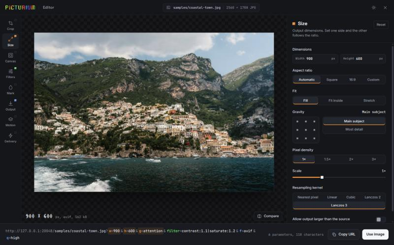
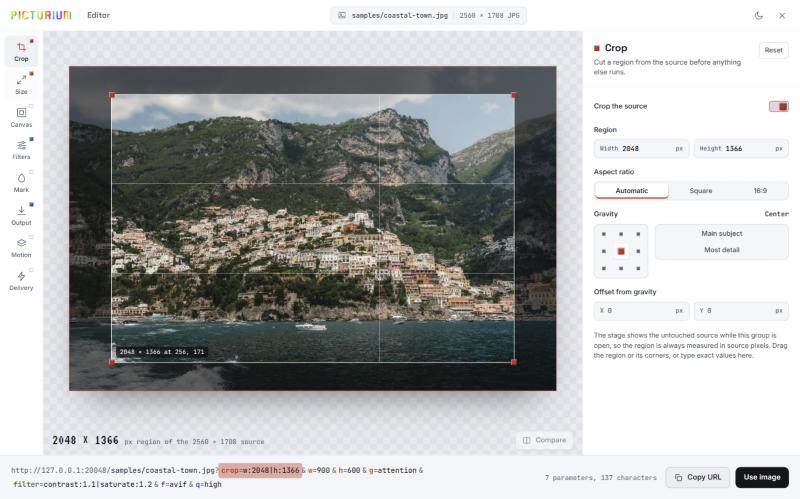

<p align="center">
  <a href="https://github.com/picturium/picturium">
    
  </a>
</p>

<h1 align="center">picturium editor</h1>

<p align="center">
  A visual editor for <a href="https://github.com/picturium/picturium">picturium</a> images that drops into any page.<br>
  Crop, resize, filter and watermark an image, watch the server render it, and get the finished URL back.
</p>

<p align="center">
  
  
  
  <a href="LICENSE"></a>
</p>

<p align="center">
  <a href="https://picturium.cc"><strong>picturium.cc</strong></a> ·
  <a href="https://picturium.cc/docs/editor">Editor docs</a> ·
  <a href="https://github.com/picturium/picturium">picturium server</a>
</p>

<p align="center">
  
</p>

## Why this editor?

picturium transforms images through URL parameters. That is ideal for code and
awkward for people: nobody wants to type `crop=w:1600|h:1200&fit=contain` into
a CMS field.

The editor puts those parameters behind plain controls. Your users drag a crop
region, move a slider and pick "Fill" or "Fit inside"; your page receives the
URL. They never need to know what picturium is.

The stage is not a CSS imitation. Every preview is rendered by your picturium
server, so what people see is what the URL returns.

<p align="center">
  
</p>

## Features

- **Every picturium parameter**: crop, size, canvas, filters, watermark, output, pages and motion, delivery
- **Real previews**: rendered by the server, with the actual output size, format and file size
- **Nothing piles up in the cache**: previews skip the server cache and the browser cache, and a slider drag costs one render
- **Five languages**: English, German, Slovak, Czech and Spanish, with your own strings on top
- **Yours to configure**: hide groups or single controls, lock the theme, swap the logo, limit the formats
- **Fits any box**: desktop, tablet and phone layouts follow the size of the element, not the viewport
- **Light and dark** themes, keyboard focus and reduced motion handled
- **Signed URLs** through a callback, so the secret never reaches the browser
- **Zero runtime dependencies**: one ES module, one stylesheet, self-hosted fonts

## Install

```bash
npm install @lamka02sk/picturium-editor
```

Or without a build step, straight from a CDN:

```html
<link rel="stylesheet" href="https://cdn.jsdelivr.net/npm/@lamka02sk/picturium-editor/dist/picturium-editor.css">
<script type="module">
  import { createEditor } from 'https://cdn.jsdelivr.net/npm/@lamka02sk/picturium-editor/dist/picturium-editor.js';
</script>
```

## Start here

```ts
import { createEditor } from '@lamka02sk/picturium-editor';
import '@lamka02sk/picturium-editor/style.css';

const editor = createEditor(document.getElementById('editor')!, {
    server: 'https://img.example.com',
    source: 'photos/coastal-town.jpg',
    onUse: (url, params) => saveImage(url, params),
    onClose: () => editor.destroy(),
});
```

```html
<div id="editor" style="height: 100vh"></div>
```

The editor fills its element and picks its layout from the element's size, so
give the element a height. It works the same in a full page, a dialog or a
sidebar.

`createEditor()` returns three methods:

```ts
editor.url();                       // the current URL, unsigned
editor.update({ locale: 'de' });    // change options in place, keeping the edited values
editor.destroy();                   // unmount
```

In a component framework, mount it once and destroy it on cleanup:

```tsx
// React
useEffect(() => {
    const editor = createEditor(ref.current!, { server, source, onUse });
    return () => editor.destroy();
}, [server, source]);
```

## Options

| Option | What it does |
| --- | --- |
| `server` | Base URL of the picturium server. Required. |
| `source` | Path of the file under the server's data directory. Required. |
| `locale` | `en`, `de`, `sk`, `cs` or `es`. Defaults to the browser language, then English. |
| `messages` | Replaces individual strings, or supplies a whole new language together with `locale`. |
| `theme` | `dark`, `light` or `auto`, which follows the operating system. |
| `logo` | Image URL of your logo, or `false` for none. |
| `title` | Text next to the logo, or `false` for none. |
| `disable` | Groups, controls and chrome to hide. |
| `formats` | Output formats on offer, for example `['auto', 'webp', 'avif']`. |
| `keys` | `true` prints picturium's parameter names (`w, h`, `fit`…) next to the labels. |
| `defaults` | What your server applies on its own. These values are left out of the URL. |
| `initial` | Values the editor opens with. |
| `section` | Group the editor opens on. |
| `previewDelay` | Milliseconds a value must rest before a preview is requested. Default 250. |
| `sign` | `(payload) => token`. Enables the "Sign the URL" switch. |
| `onUse` | "Use image" was pressed: `(url, params)`. Without it the button is hidden. |
| `onClose` | The close button was pressed. Without it the button is hidden. |
| `onChange` | The URL changed: `(url, params)`. |

## Switching features off

`disable` takes any mix of three things:

- **A group**: `crop`, `size`, `canvas`, `filter`, `mark`, `out`, `motion`, `deliv`
- **One control**, written `group.control`: `size.dpr`, `filter.blur`, `out.format`, `deliv.force`. The full list is the `Control` type in [src/types.ts](src/types.ts).
- **Chrome**: `theme` (the light/dark toggle, which also locks the theme), `url` (the URL preview in the dock), `copy`, `compare`, `source` (the source path in the top bar)

```ts
createEditor(el, {
    server, source,
    theme: 'light',
    logo: '/brand/logo.svg',
    disable: ['motion', 'deliv', 'theme', 'url', 'filter.pixelate'],
    formats: ['auto', 'webp', 'avif'],
    initial: { wmMode: 'image', wmImage: 'brand/mark.png' },
});
```

A hidden control keeps its value from `initial`, and "Reset" leaves it alone.
That is how you force a value: set it in `initial` and disable its control. The
example above stamps every image with the brand mark and gives people no way to
remove it.

## Languages

The editor ships English, German, Slovak, Czech and Spanish and picks one from
the browser language. Pin it with `locale`, and override any string with
`messages`:

```ts
createEditor(el, {
    server, source,
    locale: 'sk',
    messages: { 'url.use': 'Vložiť do článku' },
});
```

Buttons speak the user's language while the URL keeps speaking picturium:
"Fit inside" writes `fit=contain`, "Main subject" writes `g=attention`.

To add a language, copy [src/i18n/en.ts](src/i18n/en.ts), translate it and
register it in [src/i18n/index.ts](src/i18n/index.ts). TypeScript fails the
build when a key is missing. Counted messages list their plural forms, for
example `one:{n} parameter|other:{n} parameters`.

## Matching your server configuration

The editor leaves out any value that equals picturium's default. If your
`config.toml` changes a default, say so, otherwise the panel and the picture
disagree:

```ts
defaults: { fit: 'contain', q: 'high', upsize: true }
```

## Signed URLs

The editor never holds the secret. `sign` receives exactly what picturium signs,
`path?query` without the token, and returns the hex HMAC, usually from your
backend:

```ts
sign: (payload) => fetch('/api/sign?u=' + encodeURIComponent(payload)).then((r) => r.text()),
```

If the server enforces signatures, open the editor with
`initial: { sign: true }` so the previews are signed too.

## Previews are never cached

Somebody dragging a slider produces dozens of images that nobody will ask for
again. So a preview is treated as a one-off render:

- It is requested with `nocache=true`. picturium then neither reads nor fills
  its output cache and answers `Cache-Control: no-store`.
- The browser keeps nothing either.
- Requests are debounced, and a newer value aborts the one in flight.

The URL you copy or use never contains `nocache`.

## Good to know

- `nocache` needs a picturium server that knows the parameter. An older server
  ignores it, so previews still work, but they land in its cache.
- Previews are loaded with `fetch`, so the server must allow the editor's page
  as a CORS origin (`cors.allowed_origins`).
- The crop region is measured in source pixels. While the crop group is open,
  the stage shows the untouched source.
- A document output (`f=pdf`) has no preview. The URL still works.
- The editor does not parse an existing URL. To reopen an image, keep the
  `params` that `onUse` hands you and pass them back as `initial`.

## Development

```bash
npm install
npm run dev
npm test
npm run check
npm run build
```

The dev page reads its options from the query string, for example
`/?server=http://localhost:20045&source=mars.jpg&locale=sk&theme=light&disable=motion,url`.
See [demo.ts](demo.ts).

## The server

This package builds requests and shows the result;
[picturium](https://github.com/picturium/picturium) does the transformation,
caching and media delivery. See the main project for server configuration and
supported formats.

## License

MIT. See [LICENSE](LICENSE).

## AI disclosure

This editor was written mainly by AI agents and reviewed by a human.
